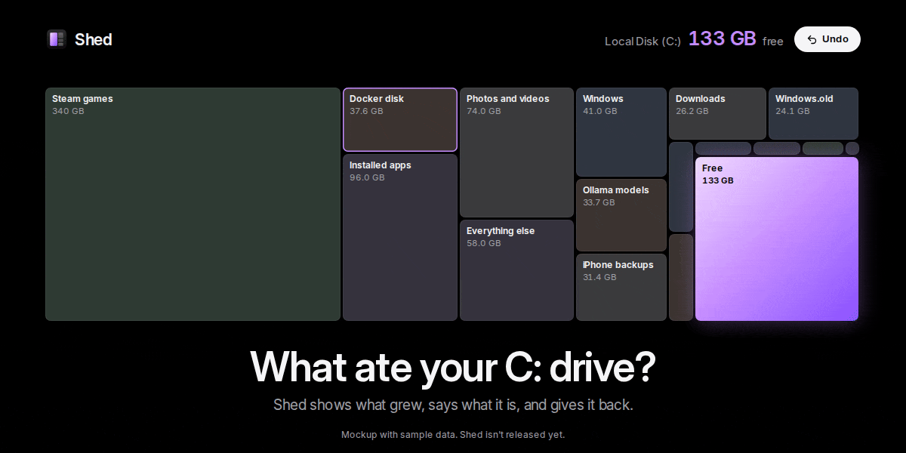
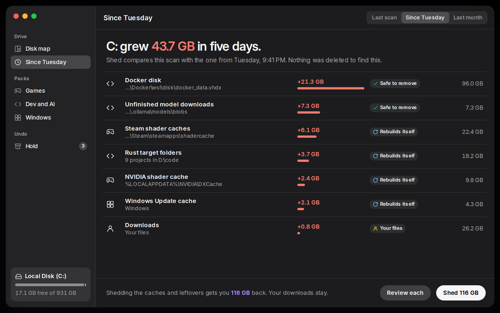
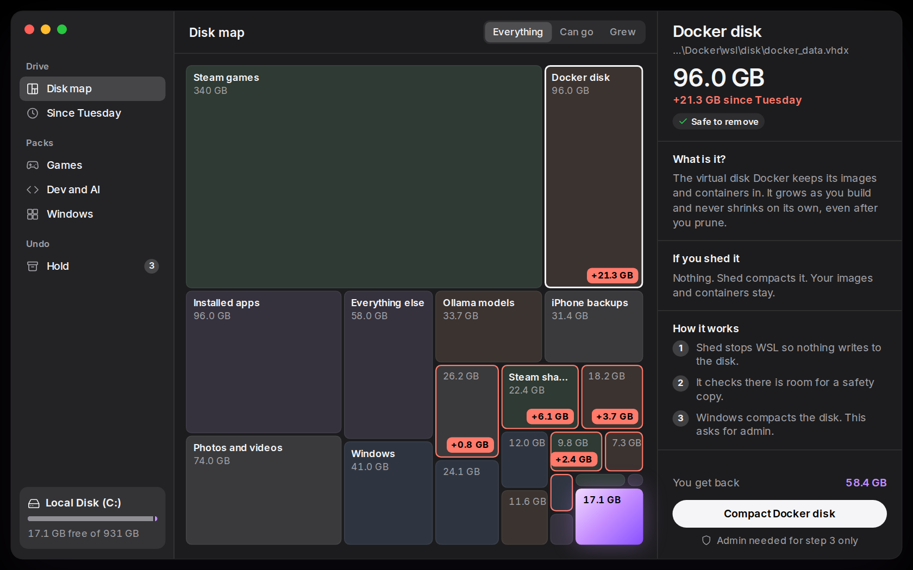
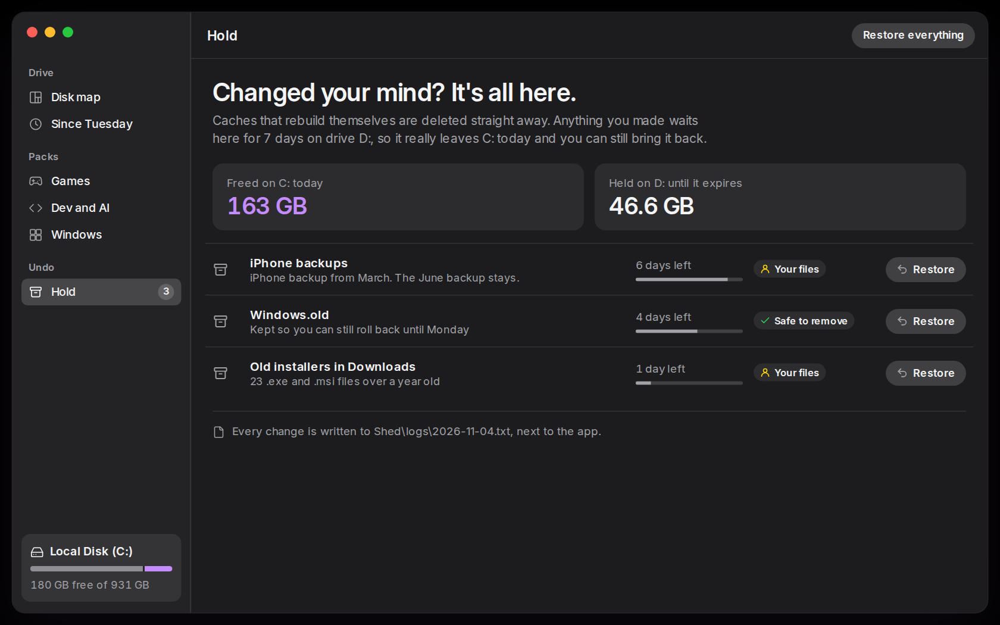

  

  
  
  
  
  

<h1 align="center">What ate your C: drive?</h1>

<b>Shed shows what grew since your last scan, says what each thing is in plain words, and gives the space back. Free. One file. Undo for 7 days.</b>

  

> [!NOTE]
> **Download:** the Windows build is a single `Shed-setup.exe` — [releases](../../releases/latest). One file, no installer, no admin rights for everyday cleaning.
>
> The build isn't code-signed yet, so SmartScreen may warn you the first time. Choose **More info**, then **Run anyway**.

## Why Shed

Your C: drive was fine last week. Now it's full and nothing tells you why. Disk maps show you what's big. Cleaners delete things without saying what they were.

**Shed remembers your last scan and shows the difference.**

| | The usual cleaner | Shed |
|---|---|---|
| **Finds** | What's big | **What grew, and when** |
| **Explains** | A checkbox and a scary name | **What it is and what happens if it goes** |
| **Undo** | None, or the Recycle Bin on the same drive | **7-day hold on another drive** |
| **Dev and AI junk** | Ignored | **Docker, WSL, node_modules, target, Ollama** |
| **Upsells** | Red warnings, Pro tier | **None. MIT.** |

## What you get

### Since Tuesday, C: grew 43.7 GB

Every scan saves a small index next to the app. The next scan shows exactly what grew since then, so "my drive filled up overnight" gets a real answer.

### Every item, in plain words

- **What it is**, which app made it, and **what breaks** if it goes.
- A badge on everything: **Rebuilds itself**, **Safe to remove** or **Your files**.
- The rules live in one open file. If one is wrong, anyone can fix it in a pull request.

### Packs that know where the space really goes

- **Games:** Steam shader caches listed by game name instead of app ID, NVIDIA and AMD shader caches, old driver installers (Shed keeps the newest two).
- **Dev and AI:** Docker and WSL disks that never shrink, compacted step by step; `node_modules` and `target` in projects you haven't touched for 90 days; half-finished Ollama downloads and old Hugging Face models.
- **Windows:** Windows.old, the hibernation file, update caches. Each shows its tradeoff before you confirm, and only these ask for admin.

### Undo for real

Caches that rebuild themselves go straight away. Anything you made waits 7 days on another drive, so it leaves C: today and still comes back with one click. Every change is written to a plain-text log.

## How it works

1. **It scans your drives** and saves a small index in its own folder.
2. **It compares** with the last index and matches each folder against open rules.
3. **It sheds** what you pick: deletes caches, moves your files to the hold, compacts virtual disks.

## FAQ

**Is it a registry cleaner or a "PC booster"?**
No. Shed only frees disk space.

**Will it delete my stuff?**
Not without asking. Your files go to the hold for 7 days first, and Downloads is never selected for you.

**Does it need admin?**
Only for Windows.old, the hibernation file and compacting virtual disks. Everything else runs as you.

## Roadmap

- [x] Brand, icon and interface direction
- [x] Scanner and scan index
- [x] Since-last-scan diff
- [x] Open rules for Windows, Games, Dev and AI
- [x] Hold and restore
- [x] Portable Windows build

## Legal

Shed isn't affiliated with Microsoft, Valve, NVIDIA, Docker or Ollama. Their names appear only to say what a folder belongs to. Shed's code and brand assets are [MIT](LICENSE). See [CREDITS.md](CREDITS.md).

  <picture>
    <source media="(prefers-color-scheme: dark)" srcset="assets/brand/logo-white.svg">
    
  </picture>

